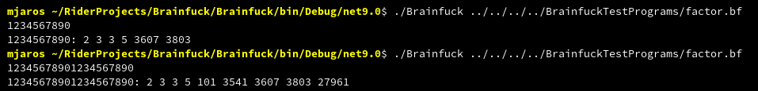
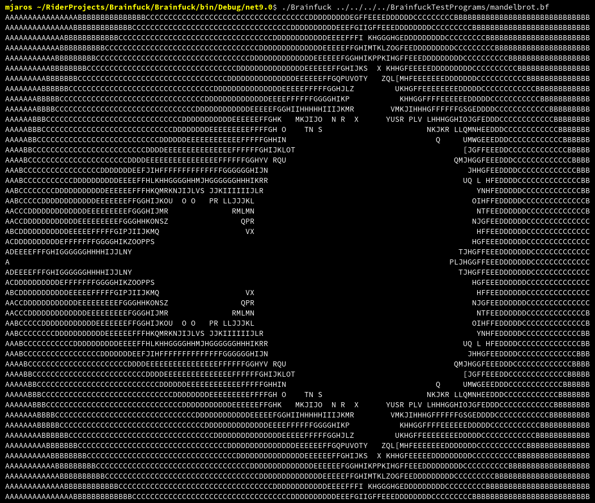

# Ukázky použití

Ve složce `BrainfuckTestPrograms` jsou dva programy napsané v jazyce Brainfuck
- factor.bf, napsaný Brianem Raiterem, získaný ze zdroje: https://github.com/eliben/code-for-blog/blob/main/2017/bfjit/tests/testcases/factor.bf
- mandelbrot.bf, napsaný Erikem Bosmanen, získaný ze zdroje: https://github.com/eliben/code-for-blog/blob/main/2017/bfjit/bf-programs/mandelbrot.bf

## factor.bf
Program, který provede faktorizaci čísla zadaného na vstupu.

## mandelbrot.bf
Program, který po spuštění vizualizuje [Mandelbrotovu množinu](https://cs.wikipedia.org/wiki/Mandelbrotova_mno%C5%BEina)

